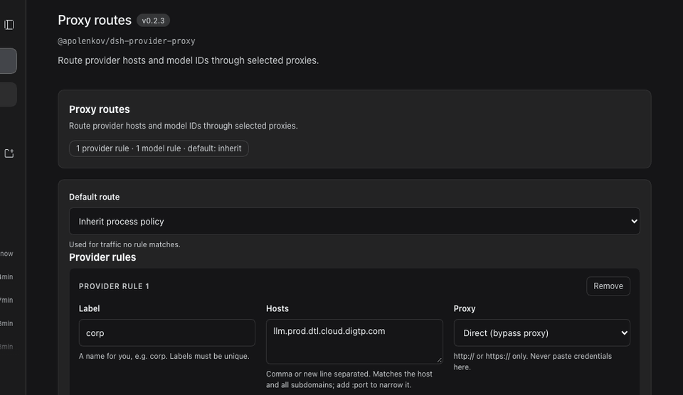

# dsh-provider-proxy

[](./LICENSE)
[](./package.json)
[](https://github.com/deepseek-ai/deepseek-harness)
[](#Разработка)

Прокси-маршрутизация исходящих запросов по провайдеру и по ID модели для [DeepSeek Harness](https://github.com/deepseek-ai/deepseek-harness).

Harness применяет **одну** прокси-политику на процесс (`HTTP_PROXY` / `HTTPS_PROXY` / `NO_PROXY` / `ALL_PROXY`). Этот плагин добавляет поверх неё две оси маршрутизации — по хосту провайдера и по ID модели — со страницы настроек Plugins, без обязательного редактирования YAML.

```text
ctx.llm.stream({ provider, model })
        │  waterfall llm/stream → AsyncLocalStorage на каждый pull стрима
        ▼
   adapter → globalThis.fetch
        ▼
   RoutingDispatcher (этот плагин)
        ├─ правило модели совпало?  → direct / proxy / inherit
        ├─ правило провайдера совпало? → direct / proxy / inherit
        ├─ loopback?                → всегда напрямую
        └─ иначе                    → политика лаунчера (env + NO_PROXY)
```

- **Ось провайдера** (`providers`): совпадение по хосту запроса — точное, поддомены, опционально `host:port`. Действует на каждый `fetch()` в процессе (LLM, веб-поиск, MCP).
- **Ось модели** (`models`): совпадение по паре `provider`/`model` вызова, выдавшего запрос. Точные id и префиксы с `*` на конце, с опциональной привязкой к провайдеру.
- **Приоритет**: точное с привязкой к провайдеру → точное без привязки → префикс с привязкой → префикс без привязки → правило провайдера → `default` (`inherit` или `direct`).

## Установка

Требуется профиль с менеджером плагинов (подходят и Desktop-приложение, и `dsh web`).

**Из git** (рекомендуется, пока пакет не опубликован под финальным npm-именем):

```sh
dsh plugin --profile <profile> add git+https://github.com/apolenkov/dsh-provider-proxy.git#<commit>
```

**Из локальной копии:**

```sh
dsh plugin --profile <profile> add /absolute/path/to/dsh-provider-proxy
# или: добавьте link-зависимость в package.json профиля и выполните там pnpm install
```

Затем перезапустите DSH. Бандл вставляет строку `provider-proxy`; маршруты хранятся в конфиге этой строки.

> Замечание про npm: пакет публикуется (или будет опубликован) под скоупом `@apolenkov/dsh-provider-proxy`; нескоупленное имя `dsh-provider-proxy` уже принадлежит несвязанному пакету в публичном реестре, поэтому никогда не выполняйте `pnpm add dsh-provider-proxy`.

## Настройка

### В интерфейсе (рекомендуется)

Откройте **Plugins** в сайдбаре → бандл **dsh-provider-proxy** → **Configure**. На странице:

- **Маршрут по умолчанию** (`inherit` или `direct`);
- **Правила провайдеров**: название, хосты (через запятую или с новой строки), прокси (`inherit` / `direct` / свой URL `http(s)://`);
- **Правила моделей**: ID модели (точный или префикс с `*`), необязательная привязка к провайдеру, прокси.

Изменения staged-локально и применяются по кнопке **Save** с защитой от гонок ревизий: если конфиг тем временем изменился, запись отклоняется, а не перезаписывает молча. Ничего не пишется до сохранения; уход со страницы отбрасывает черновик.

### В YAML

Добавьте или отредактируйте строку в `cordis.patch.yml` профиля (HMR применяет вживую, без рестарта):

```yaml
- id: provider-proxy
  name: "dsh-provider-proxy"
  config:
    default: inherit
    providers:
      corp:
        hosts: ["llm.internal.example"]
        proxy: direct
      opencode-go:
        hosts: ["opencode.ai"]
        proxy: "http://127.0.0.1:1301"
    models:
      "muse-spark-1.3-contributor":
        provider: opencode-go
        proxy: "http://127.0.0.1:1301"
      "longcat-*": inherit
```

Невалидная запись отклоняет всю конфигурацию целиком (fail-closed): плагин пишет причину в лог, оставляет прежние маршруты и никогда не применяет наполовину.

### Значения прокси

| Значение | Смысл |
|---|---|
| `inherit` | Политика лаунчера (env + `NO_PROXY`). |
| `direct` | Напрямую к origin, игнорируя политику процесса. |
| `http(s)://…` | Маршрут через этот прокси (`ProxyAgent`). SOCKS и PAC отклоняются. |

Интерфейс дополнительно отклоняет URL с учётными данными — не храните пароли в профильном патче.

## Пример: Muse Spark

Направьте одну модель через собственный прокси, а всё остальное оставьте на политике лаунчера:

```yaml
- id: provider-proxy
  name: "dsh-provider-proxy"
  config:
    default: inherit
    models:
      "muse-spark-1.3-contributor":
        provider: opencode-go
        proxy: "http://127.0.0.1:1291"
```

См. [examples/models-muse-spark.yaml](./examples/models-muse-spark.yaml) (санитизирован: только loopback-адреса, без учётных данных). То же правило создаётся на странице Plugins — запись процесса делается скриптом [assets/scripts/record-proxy-ui.sh](./assets/scripts/record-proxy-ui.sh) в [assets/gifs](./assets/gifs/).

## Проверка работы

Плагин пишет результат последнего применения (без секретов) в `$DSH_HOME/provider-proxy/state.json`:

```json
{
  "appliedAt": "2026-10-22T07:59:22Z",
  "pid": 42120,
  "status": "active",
  "routes": "muse-spark-1.3-contributor→http://127.0.0.1:1301, llm.internal.example→direct, default→inherit"
}
```

Живое правило проверяется направлением на мёртвый прокси (`http://127.0.0.1:9`): запрос должен упасть с `ECONNREFUSED 127.0.0.1:9` вместо достижения цели — затем верните настоящий прокси.

## Ограничения

- WebSocket-транспорты не гарантировано проходят через undici-диспетчер; для строгой маршрутизации используйте `http(s)`.
- `web_fetch` пиннит проверенные адреса через собственную политику лаунчера и может обходить эти маршруты; трафик моделей покрыт.
- Правила моделей действуют только внутри `llm/stream`; веб-поиск и MCP используют ось хостов.
- Правило модели не срабатывает на немодельный трафик того же хоста, а правило хоста никогда не переопределяет `localhost` / loopback.
- URL прокси с учётными данными принимаются транспортом, но отклоняются интерфейсом; предпочитайте прокси без аутентификации в URL.

## Демонстрация



Записано в тестовом профиле с loopback-прокси: откройте Configure бандла, добавьте правило модели Muse Spark, вызовите и исправьте ошибку валидации, сохраните. Отдельные кадры — в [`assets/screenshots/`](./assets/screenshots/); повторить запись можно скриптом [`assets/scripts/record-proxy-ui.sh`](./assets/scripts/record-proxy-ui.sh).

## Публикация

Чек-лист владельца для первого публичного релиза (URL репозитория, npm-скоуп, индекс маркета,
листинг в хабе): [docs/publishing.md](./docs/publishing.md). Автоматические проверки:

```sh
pnpm check:release   # строгий манифест + секреты + сгенерированный индекс + тесты
pnpm release:market  # создаёт market/dsh-market.json из package.json и HEAD
```

## Разработка

```sh
pnpm install --ignore-scripts   # или: pnpm install --frozen-lockfile
pnpm test                       # node:test, 41 тест: матчинг, приоритеты, изоляция ALS, egress, wiring, volatile-обновления, освобождение агентов, контракт клиента, логика формы UI
pnpm check                      # манифест + секреты + валидация маркета + полный набор тестов
```

См. [CONTRIBUTING.md](./CONTRIBUTING.md) (процесс, стиль коммитов, чек-лист релиза), [CODE_OF_CONDUCT.md](./CODE_OF_CONDUCT.md) и [docs/](./docs/) — индекс с архитектурой, справочником конфигурации, описанием UI, чек-листом публикации, заметками о маркете, диагностикой и глоссарием.

## Маркет

Чтобы попасть в маркет DSH, приложите индекс формата 1, проверенный командой `pnpm check:market`. Пример — [`market/dsh-market.example.json`](./market/dsh-market.example.json); боевые индексы должны заменить примерный URL репозитория и коммит. Попадание в community-хабы (например, [dsh.market](https://dsh.market/)) дополнительно требует топик `dsh-plugin` на репозитории GitHub или заявку через собственный поток хаба — см. [docs/marketplace.md](./docs/marketplace.md).

## Лицензия

MIT — см. [LICENSE](./LICENSE). Сам DeepSeek Harness — отдельный проект DeepSeek; этот плагин — community-работа, не аффилирована и не одобрена ими.
