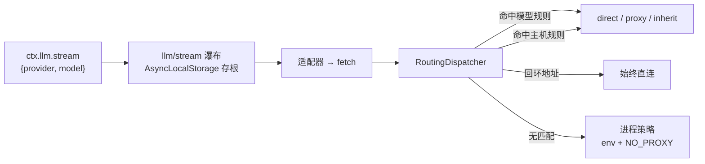

# dsh-provider-proxy

[](https://github.com/apolenkov/dsh-provider-proxy/actions/workflows/ci.yml)
[](https://www.npmjs.com/package/@apolenkov/dsh-provider-proxy)
[](./LICENSE)
[](./package.json)
[](https://github.com/deepseek-ai/deepseek-harness)
[](#开发)

[English](./README.md) · [Русский](./README.ru.md) · **中文**


为 [DeepSeek Harness](https://github.com/deepseek-ai/deepseek-harness) 提供按提供商与按模型 ID 的出站代理路由。

DeepSeek Harness 每个进程只应用**一条**代理策略（`HTTP_PROXY` / `HTTPS_PROXY` / `NO_PROXY` / `ALL_PROXY`）。本插件在其之上叠加两条路由轴 — 按提供商主机、按模型 ID — 可在设置页中配置，无需改 YAML（除非你愿意）。



- **主机轴**（`providers`）：匹配请求 URL 的主机 — 精确、子域、可选 `host:port`。作用于进程内每个 `fetch()`（模型、网页搜索、MCP）。
- **模型轴**（`models`）：匹配发出该请求的模型调用的 `provider`/`model`。支持精确 ID、以 `*` 结尾的前缀，以及可选的提供商绑定。
- **优先级**：带绑定的精确模型 → 精确模型 → 带绑定的前缀 → 前缀 → 提供商主机规则 → `default`（`inherit` 或 `direct`）。

## 安装

前提：带插件管理器的 DSH 配置（Desktop 应用与 `dsh web` 均可）。

**从 npm 安装**（推荐）：

```sh
dsh plugin --profile <profile> add @apolenkov/dsh-provider-proxy
```

**从 git 安装**（按发布标签，不经过注册表）：

```sh
dsh plugin --profile <profile> add git+https://github.com/apolenkov/dsh-provider-proxy.git#v0.2.0
```

安装后重启 DSH。插件会插入 `provider-proxy` 行；路由配置保存在该行中。

> npm 说明：包名是 `@apolenkov/dsh-provider-proxy`。不带作用域的 `dsh-provider-proxy` 属于注册表上的另一个无关包，请勿执行 `pnpm add dsh-provider-proxy`。

## 配置

### 在界面中（推荐）

打开侧边栏的 **Settings（设置）→ 代理路由**，或 **Plugins → dsh-provider-proxy → Configure**。两处是同一个编辑器：

- **默认路由**（`inherit` 或 `direct`）；
- **提供商规则**：名称、主机（逗号或换行分隔）、代理（`inherit` / `direct` / 自定义 `http(s)://` URL）；
- **模型规则**：模型 ID（精确或以 `*` 结尾的前缀）、可选的提供商绑定、代理。

修改先在本地暂存，点击**保存**后才写入，并带版本校验：若配置在别处已改动，保存会被拒绝而不是静默覆盖。表单不会被清空写入；离开页面会丢弃暂存修改。

### 在 YAML 中

在配置文件的 `cordis.patch.yml` 里添加或修改该行（HMR 实时生效，无需重启）：

```yaml
- id: provider-proxy
  name: "@apolenkov/dsh-provider-proxy"
  config:
    default: inherit
    providers:
      corp:
        hosts: ["llm.internal.example"]
        proxy: direct
      opencode-go:
        hosts: ["opencode.ai"]
        proxy: "http://127.0.0.1:1301"
    models:
      "muse-spark-1.3-contributor":
        provider: opencode-go
        proxy: "http://127.0.0.1:1301"
      "longcat-*": inherit
```

无效条目会拒绝整份配置（fail-closed）：插件记录原因、保留原有路由，绝不会只应用一半。

### 代理取值

| 取值 | 含义 |
|---|---|
| `inherit` | 使用启动器的进程代理策略（env + `NO_PROXY`）。 |
| `direct` | 直连源站，忽略进程策略。 |
| `http(s)://…` | 经该代理转发（`ProxyAgent`）。不支持 SOCKS 与 PAC。 |

界面还会拒绝带凭据的代理 URL — 不要把密码写进配置文件。

## Muse Spark 示例

把单个模型放到专用代理上，其余流量保持启动器策略：

```yaml
- id: provider-proxy
  name: "@apolenkov/dsh-provider-proxy"
  config:
    default: inherit
    models:
      "muse-spark-1.3-contributor":
        provider: opencode-go
        proxy: "http://127.0.0.1:1291"
```

见 [`examples/models-muse-spark.yaml`](./examples/models-muse-spark.yaml)（已脱敏：仅回环地址、无凭据）。

## 演示


在临时配置中用回环代理录制：打开设置页、添加 Muse Spark 规则、触发并修正校验错误、保存，最后展示 Settings 中的页面。单帧见 [`assets/screenshots/`](./assets/screenshots/)。

## 验证是否生效

插件把最近一次应用结果（不含机密）写入 `$DSH_HOME/provider-proxy/state.json`：

```json
{
  "appliedAt": "2026-10-22T07:59:22Z",
  "pid": 42120,
  "status": "active",
  "routes": "muse-spark-1.3-contributor→http://127.0.0.1:1301, llm.internal.example→direct, default→inherit"
}
```

可用“死代理”验证规则确实生效：把规则指向 `http://127.0.0.1:9`，请求应以 `ECONNREFUSED 127.0.0.1:9` 失败而不是到达目标 — 之后恢复正常代理。

## 限制

- WebSocket 传输不保证经过 undici 调度器；需要严格路由时请使用 `http(s)`。
- `web_fetch` 通过启动器自身的策略固定地址，可能绕过这些规则；模型流量已被覆盖。
- 模型规则只在 `llm/stream` 内生效；网页搜索与 MCP 走主机轴。
- 模型规则不会作用于同一主机上的非模型流量；主机规则永不覆盖 `localhost` / 回环。
- 带凭据的代理 URL 会被传输层接受，但界面会拒绝；建议使用无凭据的代理端点。

## 开发

```sh
pnpm install --ignore-scripts
pnpm test      # node:test，44 个测试：匹配、优先级、ALS 隔离、出口、装配、表单逻辑
pnpm check     # 清单 + 机密 + 市场索引 + 完整测试
```

见 [CONTRIBUTING.md](./CONTRIBUTING.md)、[CODE_OF_CONDUCT.md](./CODE_OF_CONDUCT.md)，以及 [docs/](./docs/)（架构、配置参考、UI、发布清单、市场、排障、术语表）。

## 市场

DSH 市场索引（format 1）见 [`market/dsh-market.json`](./market/dsh-market.json)，由 `pnpm release:market` 依据清单与发布提交生成；插件已带 `dsh-plugin` 话题，社区目录 [dsh.market](https://dsh.market/) 会自动收录。

## 许可

MIT — 见 [LICENSE](./LICENSE)。DeepSeek Harness 属于 DeepSeek 的独立项目；本插件为社区作品，与其无隶属或背书关系。
