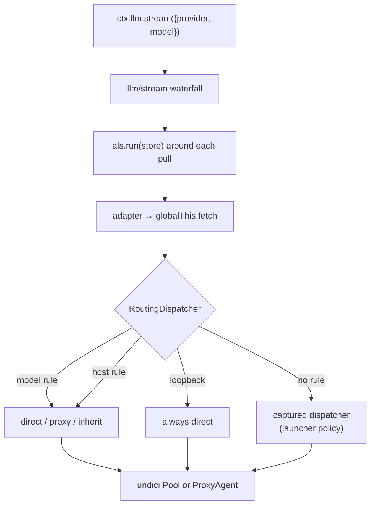
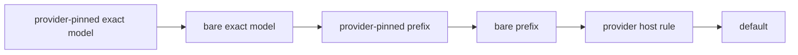
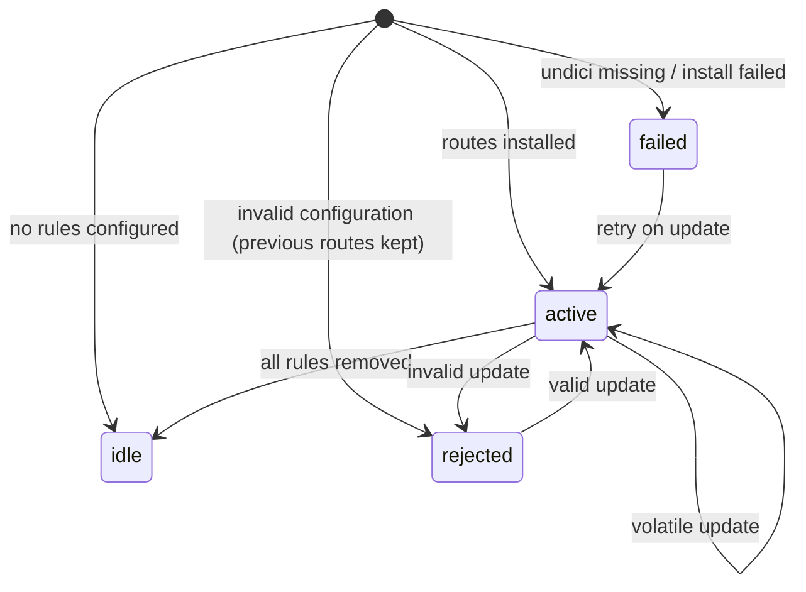

# Architecture

## One paragraph

DeepSeek Harness installs a single undici global dispatcher from the launch environment. This plugin wraps that dispatcher: every outgoing request is routed per dispatch call, first by the model call that issued it (`provider`/`model` from the `llm/stream` waterfall, carried in an `AsyncLocalStorage` store), then by the request host, otherwise by the previously installed policy. Loopback is always direct. An invalid configuration refuses the whole route set rather than routing anything surprisingly.

## Flow

Resolution order inside the dispatcher (first match wins):

Apply outcomes recorded in `state.json`:

## Files

| File | Role |
|---|---|
| `index.js` | Cordis plugin: validates config against `Config`, installs/restores the dispatcher, opens the model store on `llm/stream`, commits volatile updates, writes diagnostics. |
| `core.js` | Pure routing: normalize, match, resolve, wrap async iterables, build the dispatcher. No DSH imports at module load; the plugin injects `undici`. |
| `client/client.js` | Browser half: the Proxy routes page registered on `plugins.bundle.config` for this bundle. |
| `cordis.patch.yml` | Bundle patch inserting the `provider-proxy` row. Routes belong to the profile entry, never to this file. |

## Why not `globalThis.fetch`

Model-facing SDKs capture `fetch` at client construction and adapters cache those clients across requests, so wrapping `fetch` is unreliable after the first call. The undici global dispatcher is resolved per request and cannot be captured early, which makes it the only sound interception point.

## Why not put the model id in `GenerateOptions`

Loop-built requests arrive deep-frozen; extensions and adapters may read them but must not rewrite them. The `llm/stream` waterfall already carries `{ provider, model }`, so the plugin observes the pair there and stores it around each stream pull. Concurrency is isolated per model call.

## Failure semantics

- Invalid configuration: log, keep the previous policy (or no dispatcher), write `state: rejected`. Never throw from `apply`.
- Missing `undici` or dispatcher install failure: log, write `state: failed`, keep the previous policy.
- Uninstall/dispose: restore the previously captured dispatcher and close only owned pools and proxy agents.
- Stale settings writes: the settings service refuses them (`settings-conflict`); the UI preserves the draft and asks to reload or overwrite.
