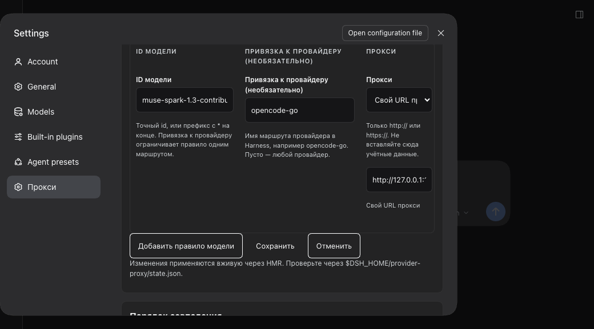
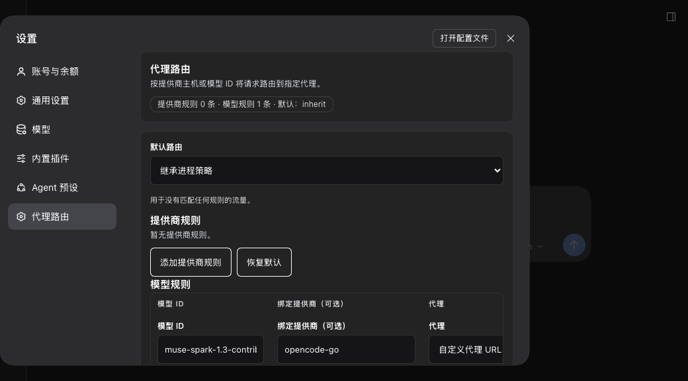
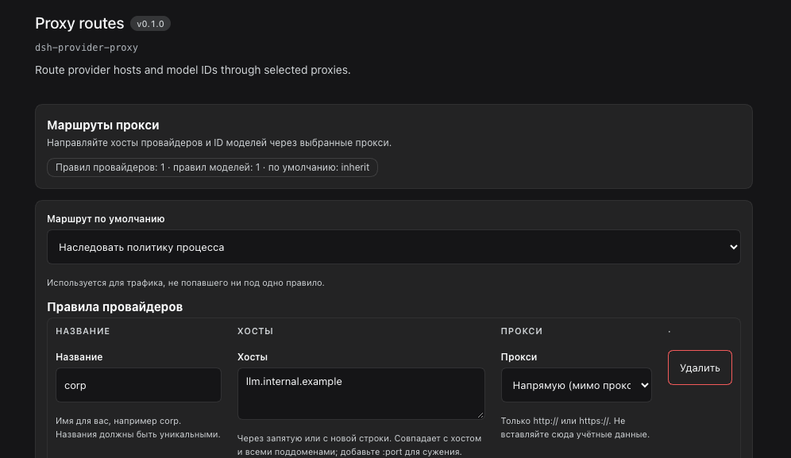

# Proxy UI

The same editor is reachable from two seats, so nobody has to learn both:

1. **Settings → Прокси / Proxy routes** — a first-class settings page beside **Models**. This is where most people will look.
2. **Plugins → dsh-provider-proxy → Configure** — the bundle's own row page.

Both seats edit the Host entry `provider-proxy` through the shared settings form; there is one implementation and one source of truth.

The page follows the harness locale (Settings → General → Language), not the
browser language: `en`, `zh`, and a plugin-provided `ru` dictionary.
Switching the harness to 中文 renders the whole page in Chinese:

## Why these two seats, and not the Models provider card

The Models page exposes `settings.models.provider-card`, keyed by the provider's
settings namespace, for **adapter-family plugins** that own that namespace. This
plugin is not an adapter family: it has no namespace of its own, and a keyed
registration would *replace* whichever plugin owns the key. It therefore adds its
own `settings.section` page instead, next to Models, and leaves the provider
cards untouched. The UI still uses the Model/Provider vocabulary, so the two
pages read the same way.

## What you see

- A summary line: rule counts and the default route.
- **Default route** select (`inherit` / `direct`).
- **Provider rules** table: label, hosts, proxy (inherit / direct / custom URL).
- **Model rules** table: model ID, optional provider pin, proxy.
- Save / Discard / Reset to defaults, plus a precedence reminder and a diagnostics note.

The page renders inside the plugin manager’s bundle-configuration slot between the bundle description and its rows. The Models page is untouched: this page mirrors the model/provider vocabulary but writes a different entry.

## Behavior

- Nothing is written until **Save**. Leaving the page drops staged edits.
- Every write carries the settings revision the form was read at; a stale write is refused instead of silently overwriting, and the page offers reload-or-overwrite.
- Validation runs on blur and on save: inline errors under the offending field, linked from a keyboard-focusable error summary.
- Proxy URLs with embedded credentials are refused by the page (keep secrets out of the profile patch).
- Saving applies live through HMR: the host replaces the route table atomically and updates `$DSH_HOME/provider-proxy/state.json`.

## Accessibility

- Visible labels on every input; no placeholder-only fields.
- `aria-invalid` and `aria-describedby` link each field to its hint and error.
- Error summary uses `role="alert"`, receives focus on failed submit, and links to fields.
- Controls are at least 44px tall; tables scroll horizontally on narrow screens instead of overflowing.
- Motion respects `prefers-reduced-motion`.
