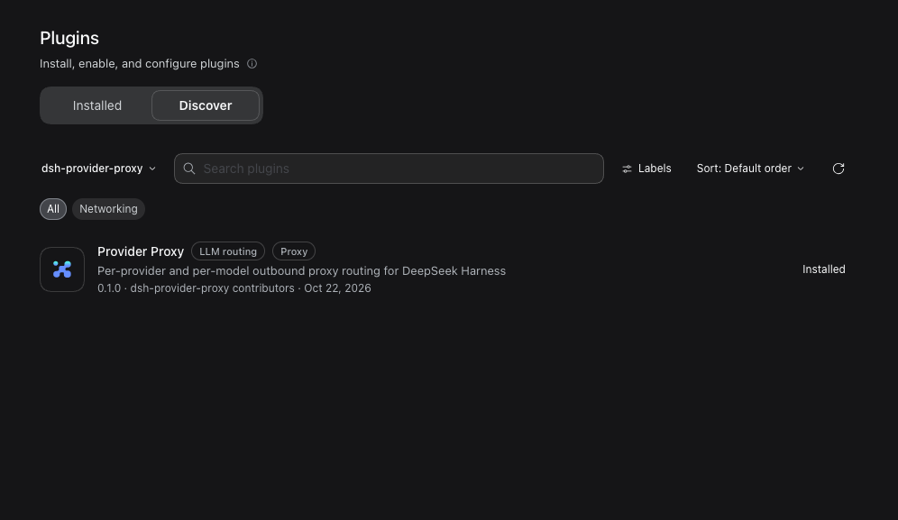
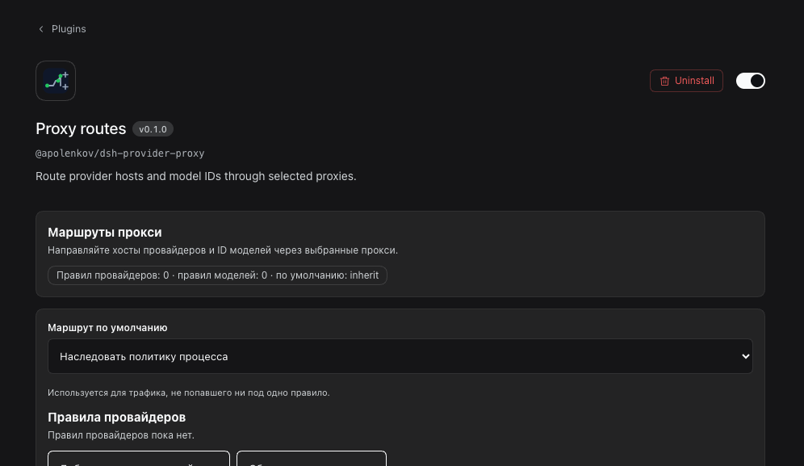
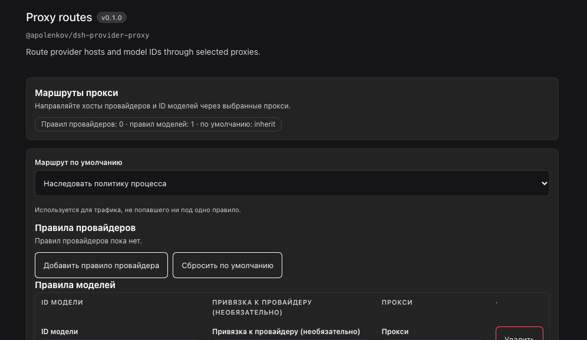

# Publishing and marketplace release

This is the owner-side checklist that turns this repository into a public,
installable, market-listed plugin. Everything mechanical is automated; only the
identity decisions below need a human.

## 0. Decisions only the owner can make

| Decision | Why it is not automated | Recommendation |
|---|---|---|
| ~~Public repository URL~~ | Decided | `https://github.com/apolenkov/dsh-provider-proxy` |
| ~~npm package name~~ | Decided | `@apolenkov/dsh-provider-proxy` — the unscoped name belongs to an unrelated package (v0.6.0) |
| ~~npm publish~~ | Done | `@apolenkov/dsh-provider-proxy@0.1.0` is on the public registry |

Git-only distribution needs neither decision: `dsh plugin add git+ssh://…` works
today and is documented in the README.

## 1. Repository and package identity (decided)

- Public repository: <https://github.com/apolenkov/dsh-provider-proxy> (public, topics `dsh-plugin`, `deepseek-harness`, `proxy`, `model-routing`).
- npm package name: `@apolenkov/dsh-provider-proxy`.
- Production market index: `market/dsh-market.json`, generated with `pnpm release:market`.

## 2. Point the repository at its public home

```sh
# repository URL (no angle brackets, canonical https form)
npm pkg set repository.url="git+https://github.com/apolenkov/dsh-provider-proxy.git"

# only when publishing to npm under a scope
```

The package name is already final: `@apolenkov/dsh-provider-proxy`. It appears in
`package.json`, `cordis.patch.yml` (loader `name`), the browser module ids in
`client/client.js` and its chunks, and the examples. The contract test fails if
the bundle id drifts from the manifest name.

## 2. Verify before anything leaves the machine

```sh
pnpm install --frozen-lockfile --ignore-scripts
pnpm check            # manifest, secrets, market example, full test suite
pnpm check:release    # strict: refuses placeholders + validates the generated index
```

`check:release` fails while `package.json` still has an owner placeholder in the
repository URL — that guard is now satisfied.

## 3. Publish

**Git (always available):**

```sh
git tag v0.1.0 && git push --follow-tags
dsh plugin --profile <profile> add "git+https://github.com/apolenkov/dsh-provider-proxy.git#$(git rev-parse HEAD)"
```

**npm (published):**

```sh
npm publish --access public     # done for 0.1.0
dsh plugin --profile <profile> add @apolenkov/dsh-provider-proxy
```

The unscoped name cannot be published: the registry already has
`dsh-provider-proxy@0.6.0` from another author, which is why the package uses
the `@apolenkov` scope.

## 4. Produce the market index

```sh
pnpm release:market             # writes market/dsh-market.json from package.json + HEAD
pnpm check:market               # validates market/dsh-market.example.json
node scripts/verify-market.mjs market/dsh-market.json
```

Commit `market/dsh-market.json` with the release tag, or host it wherever your
index is served. `market/dsh-market.example.json` stays a template.

## 5. Marketplace index — verified end to end

The generated index works in a real DSH profile with the experimental market
bundle enabled:

1. `plugin-market` row configured with
   `https://raw.githubusercontent.com/apolenkov/dsh-provider-proxy/main/market/dsh-market.json`.
2. **Plugins → Discover** lists the entry with its icon, title, labels, author,
   and version.
3. **Install** fetches the git source pinned in the index
   (`github:apolenkov/dsh-provider-proxy#<commit>`), adds it to the profile, and
   the bundle page opens with the Proxy routes configuration UI.





## 6. Directory submissions

Submitted on 2026-10-22 (each PR adds one entry, per that list's rules):

| Directory | Pull request | Notes |
|---|---|---|
| `awesome-dsh-plugin/awesome-dsh-plugin` | ready, opens after the 24 h repo-age gate | `data/plugins/apolenkov__dsh-provider-proxy.yml`, category `model` |
| `beancookie/awesome-dsh-plugin` | [#235](https://github.com/beancookie/awesome-dsh-plugin/pull/235) | one line in `README.md` + `README.en.md`, alphabetical |
| `kejixiaoliang/awesome-dsh-plugins` | [#148](https://github.com/kejixiaoliang/awesome-dsh-plugins/pull/148) | `plugins/infrastructure-dev.md`, runtime section |
| `dshworks/awesome-dsh-plugins` | [#182](https://github.com/dshworks/awesome-dsh-plugins/pull/182) | `data/plugins.json` entry, `validate` + `render` run |

`bruc3van/awesome-dsh-plugin` requires more than 10 stars for a self-submission;
resubmit after the repository gains traction.

## 7. List in the community hub

1. Add the `dsh-plugin` topic to the public repository (the hub discovers plugins by topic).
2. Open a submission issue through [dsh.market](https://dsh.market/) if the hub requires one.
3. After acceptance, add the hub badge to both READMEs.

## 8. After release

- Verify the published bundle loads: install it into a scratch profile, open
  Plugins → provider-proxy → Configure, and confirm `$DSH_HOME/provider-proxy/state.json`
  reports `active` with the expected routes.
- Record the walkthrough GIF against that scratch profile with
  [`assets/scripts/record-proxy-ui.sh`](../assets/scripts/record-proxy-ui.sh).
- Update `CHANGELOG.md` with the released version and date.

## Verified state (2026-10-22)

- Repository: <https://github.com/apolenkov/dsh-provider-proxy> — public, `dsh-plugin` topic set.
- Release tag `v0.1.0`; CI green on `main` (`.github/workflows/ci.yml`).
- Installed from the public URL into a scratch profile and loaded in the browser:

  ```sh
  dsh plugin --profile <profile> add "git+https://github.com/apolenkov/dsh-provider-proxy.git#v0.1.0"
  ```

  

- `$DSH_HOME/provider-proxy/state.json` reported `status: active` with
  `opencode-go/muse-spark-1.3-contributor→http://127.0.0.1:1291, default→inherit`.
- npm: `@apolenkov/dsh-provider-proxy@0.1.0` is published; the package page is
  <https://www.npmjs.com/package/@apolenkov/dsh-provider-proxy>.
- The marketplace index currently records the **git** source (tag commit), because the
  0.2.0 npm publication is waiting for an interactive 2FA confirmation. Regenerate the
  index with `pnpm release:market` (npm source) once 0.2.0 is on the registry.
